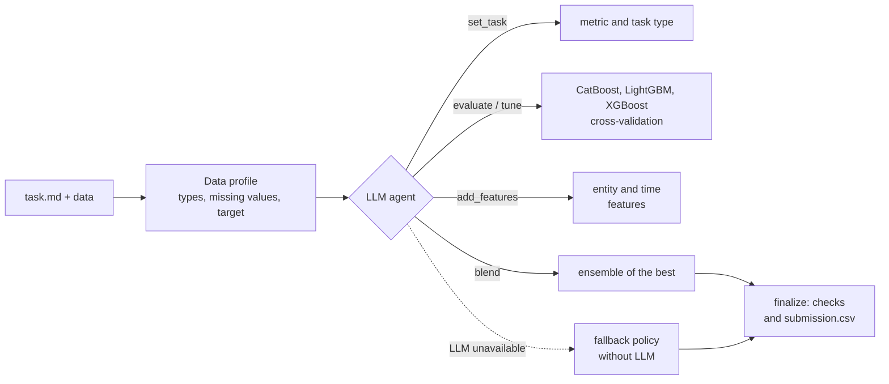
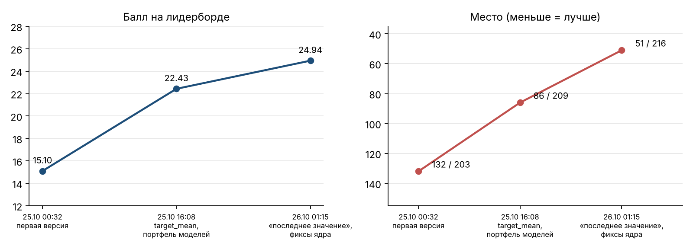
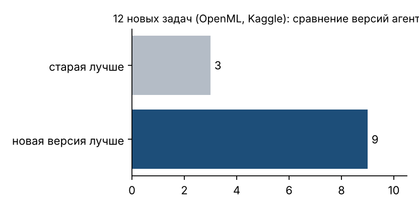

# Autonomous AutoML Agent

[Русская версия](README.md)

An LLM agent that solves a tabular ML task on its own: it reads the task, looks at the data, picks the metric, trains and compares models, and submits the best `submission.csv`. No human in the loop.

Built at the Alfa-Future Hackathon 2026 (AutoML track, October 23–26) by a team of 5. Result: **55th place out of 226**.

## My part

The team split the work into blocks. I owned the LLM agent and everything around it:

- `agent_llm.py`: function-calling loop over an OpenAI-compatible API, dialog history compression so the agent doesn't run out of context, early-finish hints;
- `solution.py`: entry point, time budget, a fallback policy without the LLM for when the model fails or doesn't respond, final submission check;
- `tests/test_agent.py`: 30 tests where the LLM is replaced by a pre-recorded script, plus a run on external tasks (`tests/external_tasks.py`).

The ML core (`ml_*.py`, `agent_tools.py`) was written by other team members. The description below covers the whole agent.

## How it works



The agent has seven tools: `set_task`, `evaluate`, `tune`, `add_features`, `blend`, `finalize`, `finish`. Every call returns a table of runs, and the agent decides what to do next based on it. When time runs out or there is no improvement, `solution.py` stops the search and submits the best result found.

## Results

**Leaderboard.** Over three submissions the score went from 15.10 to 24.94 and the place from 132 to 51. On the final private leaderboard the team finished 55th out of 226.



What moved the score:
1. First working version: agent plus core.
2. Target mean by entity key, deeper XGBoost and a portfolio of model configurations.
3. "Last known value" feature per entity, core fixes and a closed leak in grouped validation.

**Unseen tasks.** To avoid overfitting the agent to the two public tasks, I ran it on 12 unfamiliar datasets from OpenML and Kaggle (credit risk, customer churn and others). The new version beat the old one on 9 of 12.



## Run

```bash
pip install catboost lightgbm xgboost scikit-learn pandas numpy
cp .env.example .env               # OPENAI_API_KEY, OPENAI_BASE_URL, OPENAI_MODEL
python solution.py path/to/task    # folder with task.md and data
python -m unittest discover tests
```

The LLM is called over plain HTTP to an OpenAI-compatible API, no SDK. If there is no key or the model doesn't respond, the agent switches to the fallback policy and still submits a solution.

## Stack

Python, OpenAI-compatible API (function calling), CatBoost, LightGBM, XGBoost, scikit-learn, pandas, unittest.
