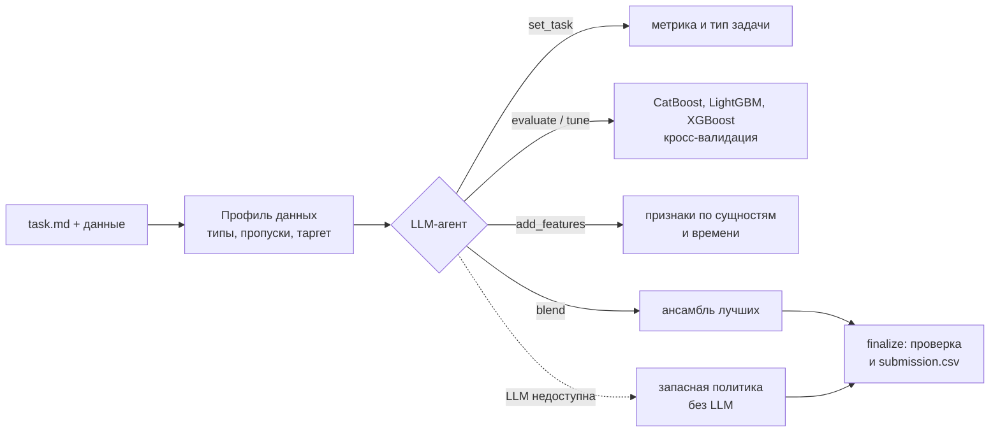
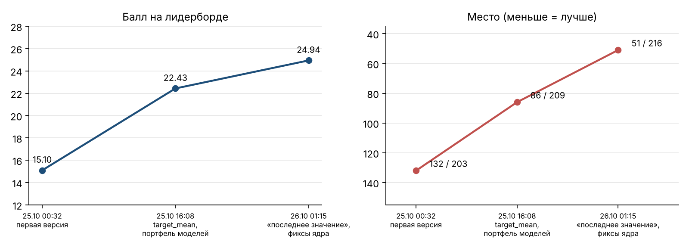
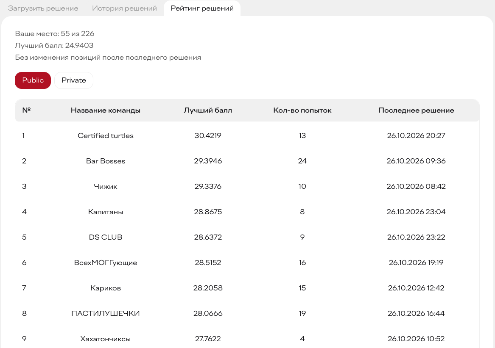
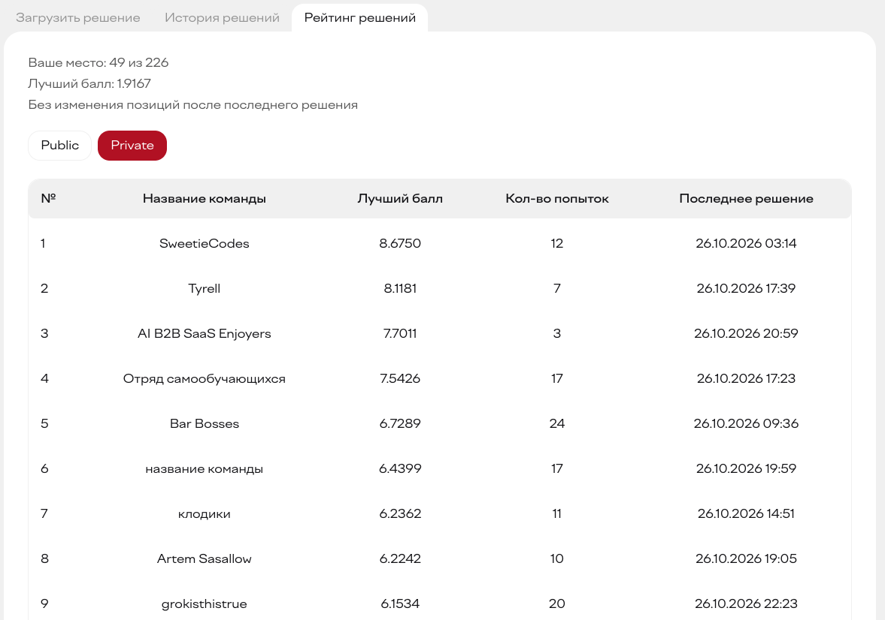
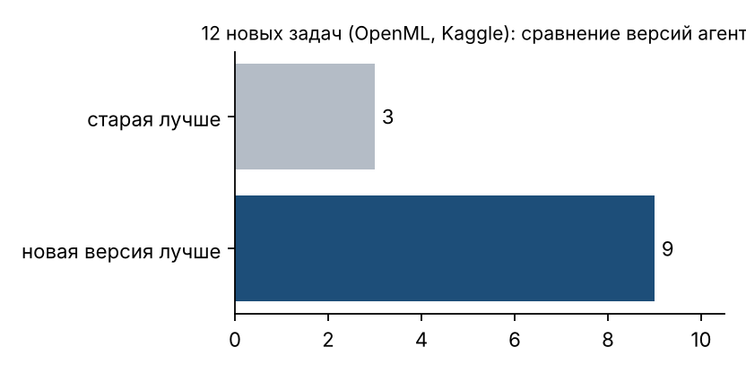

# Автономный AutoML-агент

[English version](README.en.md)

Агент на LLM, который сам решает табличную ML-задачу: читает условие, смотрит данные, выбирает метрику, обучает и сравнивает модели и сдаёт лучший `submission.csv`. Человек в процессе не участвует.

Сделан на Альфа-Будущее Хакатоне 2026 (трек AutoML, 23–26 октября) командой из 5 человек. Итог: **49 место из 226 на приватном лидерборде** (55 на публичном).

## Что здесь моё

Команда делила работу на блоки. Я отвечал за LLM-агента и всё вокруг него:

- `agent_llm.py`: цикл function calling поверх OpenAI-совместимого API, сжатие истории диалога, чтобы агент не упирался в контекст, подсказки на раннее завершение;
- `solution.py`: точка входа, бюджет по времени, запасная политика без LLM на случай, если модель упала или не ответила, финальная проверка сабмита;
- `tests/test_agent.py`: 30 тестов, в которых LLM заменена заранее записанным сценарием, плюс прогон на внешних задачах (`tests/external_tasks.py`).

ML-ядро (`ml_*.py`, `agent_tools.py`) делали другие участники команды. Ниже описан весь агент целиком.

## Как это работает



У агента семь инструментов: `set_task`, `evaluate`, `tune`, `add_features`, `blend`, `finalize`, `finish`. Каждый вызов возвращает таблицу запусков, и по ней агент решает, что делать дальше. Если время на исходе или улучшений нет, `solution.py` останавливает поиск и сдаёт лучший найденный вариант.

## Результаты

**Лидерборд.** За три отправки балл вырос с 15.10 до 24.94, место поднялось со 132 до 51. Финал: 55 место из 226 на публичном лидерборде и **49 из 226 на приватном**.



<details>
<summary>Скриншоты рейтинга с платформы</summary>

Публичный лидерборд: 55 из 226



Приватный лидерборд: 49 из 226



</details>

Что давало прирост:
1. Первая рабочая версия: агент плюс ядро.
2. Среднее таргета по ключу сущности, более глубокий XGBoost и портфель конфигураций моделей.
3. Признак «последнее известное значение» сущности, исправления ядра и закрытая утечка при группировке.

**Проверка на новых задачах.** Чтобы не подгонять агента под две публичные задачи, я прогнал его на 12 незнакомых датасетах с OpenML и Kaggle (кредитный риск, отток клиентов и другие). Новая версия обошла старую в 9 из 12.



## Запуск

```bash
pip install catboost lightgbm xgboost scikit-learn pandas numpy
cp .env.example .env               # OPENAI_API_KEY, OPENAI_BASE_URL, OPENAI_MODEL
python solution.py path/to/task    # папка с task.md и данными
python -m unittest discover tests
```

LLM вызывается через обычный HTTP к OpenAI-совместимому API, без SDK. Если ключа нет или модель не отвечает, агент переходит на запасную политику и всё равно сдаёт решение.

## Стек

Python, OpenAI-совместимый API (function calling), CatBoost, LightGBM, XGBoost, scikit-learn, pandas, unittest.
